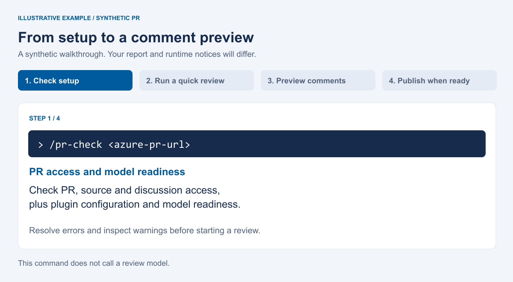
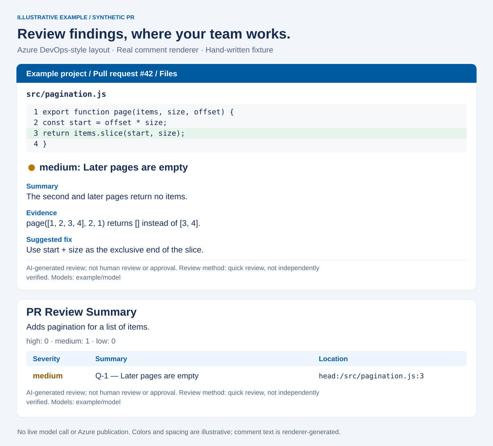

# See a review before installing

This is an **illustrative example / synthetic PR**, not an Azure DevOps
screenshot or an OpenCode session recording. A hand-written pagination defect
shows the comment format and the commands you would use. No live model was
called and no Azure comment was published to make this example.

## A short walkthrough

The animation shows four steps, takes 21 seconds and plays twice. Its pacing is
for reading; it does not measure review latency. Prefer no animation? Use the
[static walkthrough](assets/walkthrough.svg) or the text below.



1. **Check setup and PR access:** run `/pr-check <azure-pr-url>`, replacing the
   placeholder with a real PR you are authorized to review. The command checks
   PR, source and discussion access, plus plugin configuration and model
   readiness. Resolve errors and inspect warnings. This deterministic check
   does not call a review model.
2. **Review:** run `/pr-quick <azure-pr-url>` for the same PR in your OpenCode
   conversation.
   Wait for completion, then inspect findings and coverage gaps. Quick review
   uses one reviewer per shard, without an independent verifier. Findings are
   `REPORTED`, and verification is `none`; a session can make multiple model
   requests.
3. **Preview:** run `/pr-comment` in the same conversation. A model plans the
   inline comments and summary; the preview does not write to Azure. Read the
   proposed text and skips before deciding whether to publish.
4. **Publish only when ready:** `/pr-comment --publish` uses the saved preview.
   The runtime rechecks the PR, skips existing markers and writes the comments.
   Inspect the publication receipt for results. This optional step writes to
   Azure; it was not executed for this demo.

The example is one small PR and one finding, not a promise about the number of
sessions, requests, findings or cost for your PR. See [Commenting](COMMENTING.md)
for publication details, retries, markers and their limits.

## What the comments look like



The layout, colors and spacing are illustrative. The comment text and summary
index come from the project's comment-plan validator and renderer, supplied
with a hand-written fixture. `example/model`, the repository, PR, code and
finding are synthetic. The illustration simplifies formatting; read the
[exact generated comment bodies](assets/example-comments.md) for accessible
Markdown, including the disclosure and headings. Hidden publication markers
are omitted from that document.

The example code passes the page size as `Array.slice`'s end index. For page
size 2 and offset 1, both the start and end are 2, yielding an empty array.
The suggested change is `items.slice(start, start + size)`. This is a teaching
example, not evidence of review accuracy. [Validation](VALIDATION.md) records
actual tests and distinguishes simulated services from live runs.

## Reproduce these illustrations

From the repository root, with Node.js 22.12 or later:

```sh
node docs/assets/generate-demo.mjs
```

This uses only Node.js and the existing source modules. It validates the
synthetic plan, assembles the real comment text and regenerates
`review-example.svg`, `walkthrough.svg` and `example-comments.md`. It makes no
network requests, starts no model session and needs no credentials.

Regenerating the optional GIF also needs existing installations of
[Sharp](https://sharp.pixelplumbing.com/) for SVG rendering and
[Pillow](https://pillow.readthedocs.io/) for GIF encoding. These are documentation
tools, not plugin dependencies. With Sharp resolvable by Node and Pillow
available in Python:

```sh
node docs/assets/generate-demo.mjs --frames
python3 docs/assets/generate-demo-gif.py
```

For a separately installed Sharp package, set `AZPR_DEMO_SHARP` to its absolute
package directory when running the first command. Intermediate PNGs go only to
`.local/project-launch-demo-assets/`; they must not be committed. The checked-in
SVG, GIF and Markdown files can be viewed without these optional tools.
