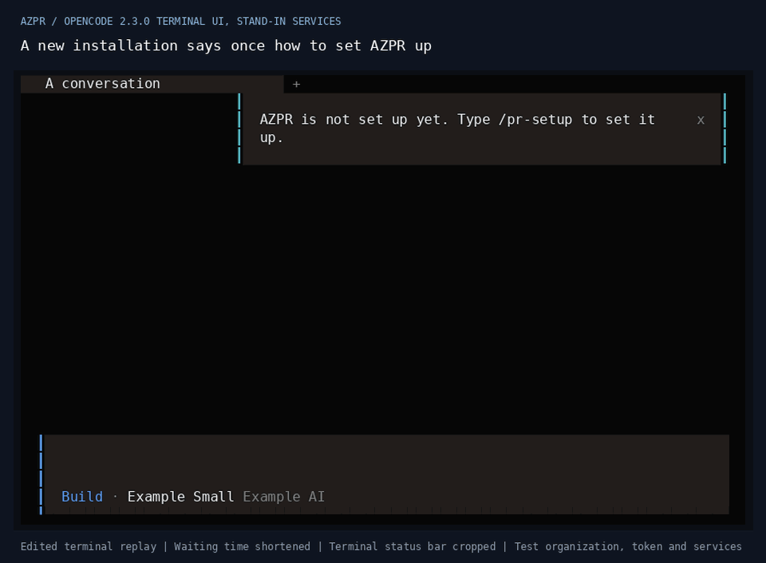

# Your first review

This guide gets you from a clean installation to a private comment preview.
Use a small, active Azure DevOps Services PR for the first run. Steps 1 and 2
run in a terminal; the rest runs in OpenCode's terminal UI. Without the
terminal UI (the desktop app, a script), set AZPR up as
[without the terminal UI](#without-the-terminal-ui) shows instead of step 3.

Already using an earlier version? Follow [upgrading](../README.md#upgrading)
instead, to keep your configuration and one AZPR installation.

## 1. Check the prerequisites (terminal)

- **OpenCode CLI 2.3.0** (`@opencode/cli`, V2 plugin API), tested on **Ubuntu
  22.04.5 LTS (WSL2)**. Other host versions and operating systems are not
  validated; see [validation](VALIDATION.md). OpenCode 1.x is not supported.
- An authenticated OpenCode model with tool support. AZPR uses your existing
  provider account; setup lists the models to choose from.
- Your Azure DevOps organization (the `<org>` in `https://dev.azure.com/<org>`)
  and an organization-scoped PAT. The recommended scopes are **Code: Read** and
  **Pull Request Threads: Read & write**; see
  [access and validation limits](ENTERPRISE.md).
- Access to the npm registry for the npm package, or Git for the Git package.
  AZPR has no build step or npm dependencies. Behind a company proxy, set up
  the terminal first: see [company networks](ENTERPRISE.md#company-networks).

```sh
opencode --version
opencode models
```

## 2. Install the package (terminal)

```sh
opencode plugin add opencode-azure-devops-pr-review@0.4.4
```

This is the host's native package installation; no npm account or separate
build is needed. OpenCode 2.3.0 loads the plugin into a running OpenCode
service within a few seconds, and otherwise when OpenCode next starts. The
plugin exposes `/pr-setup` even before its review configuration exists.

To install the same release from Git instead of the npm registry, use
`opencode plugin add 'github:WTLAIB/opencode-azure-devops-pr-review-v2#v0.4.4'`.
Add only one of the two. For a source archive or an existing source
installation, see [other installation methods](#other-installation-methods).

## 3. Set AZPR up (OpenCode's terminal UI)

Open OpenCode in your terminal and start an ordinary conversation. OpenCode
says once that AZPR is not set up yet. Type:

```text
/pr-setup
```

If `/pr-setup` is not listed, run `opencode service restart` in your terminal
and reopen OpenCode. Dialogs then ask for what a review cannot run without:



*AZPR's dialogs in OpenCode 2.3.0's terminal UI, recorded with a test
organization and token and a stand-in for Azure DevOps; waiting time is
shortened, and the model list is the one of the OpenCode that was recorded.
The command palette (`ctrl+p`) opens the same dialogs with "AZPR: settings",
which is how this recording starts.*

1. **Organization.** The name from `https://dev.azure.com/<organization>`, or
   paste the URL of your PR.
2. **Proxy.** Only if your network reaches `dev.azure.com` through one; press
   Enter to skip it. It is asked first because the next step needs the
   network. With a proxy, the next dialog takes the CA certificate file of a
   company that inspects HTTPS; Enter skips that too. See
   [company networks](ENTERPRISE.md#company-networks).
3. **Token.** Create a PAT at the address the dialog shows, with **Code: Read**
   and **Pull Request Threads: Read & write**, and paste it. The field shows
   only how many characters it holds. AZPR asks Azure DevOps once whether the
   token works for your organization. A refused token is asked for again with
   the reason. If Azure DevOps cannot be reached, you can set the proxy or the
   CA file there and try the same token again.
4. **Model.** Pick one from OpenCode's list (type to search). It fills the
   reviewer and verifier roles and `/pr-quick`.

After a summary, AZPR saves the token alone in a file only you can read
(mode 600, `${XDG_CONFIG_HOME:-~/.config}/azpr/pat-<organization>`, a file
it makes for this) and the settings beside it, and loads them at once: no
restart is needed. The token is not shown again and is in no conversation,
notice or log.

Run `/pr-setup` again at any time to see the settings as a list and change
one: a model for `/pr-deep`, the output language, the proxy, a new token and
others (see [setup](../README.md#setup-in-the-terminal-ui)). A change to
settings that are in use takes effect after `opencode service restart`; the
list says so. What the list does not hold is in the settings file it names;
[all settings and defaults](../README.md#all-settings-and-defaults) describes
each one.


## 4. Check access without a model request (OpenCode)

In OpenCode, replace this sample with your PR's URL:

```text
/pr-check https://dev.azure.com/YOUR_ORGANIZATION/YOUR_PROJECT/_git/YOUR_REPO/pullrequest/123
```

Wait for the final `READY` receipt after `STARTED`. This reads PR metadata,
changed files, sample source and discussions, and checks the model catalog;
it neither runs a review nor tests model-provider authentication or Azure write
permissions. Fix any `NOT_READY` result before continuing. A **Quick model
WARNING** also needs fixing before `/pr-quick`, even if the overall result is
`READY`; a **Deep model** WARNING likewise before `/pr-deep`. The **Deep models**
row says whether `/pr-deep` is set up (see below), and the **AZPR** row names
the installation that answered. The **OpenCode** row names the host version; a
WARNING there means it is not the tested 2.3.0, and reviews still run.

On a host without `permission.hook`, **Project boundary WARNING** means the
host's own permission rules control where native read tools can read; reviews
remain available. The tested OpenCode 2.3.0 host has that hook. `READY` is an
access check, not a security audit or an approval of the PR.

## 5. Run a review and preview its comments (OpenCode)

```text
/pr-review https://dev.azure.com/YOUR_ORGANIZATION/YOUR_PROJECT/_git/YOUR_REPO/pullrequest/123
```

This starts functional and risk reviewers, followed by separate verification.
The starter setup uses the same model in separate sessions; you can assign
models per role later. For a lighter pass, use `/pr-quick <PR URL>`
instead: it runs one reviewer per shard without independent verification.
`/pr-review --help` (and every other command with `--help`) shows the options
without running a model.

In the terminal UI a panel opens beside the conversation: it lists the
review's sessions while they run, and then shows the report and the comment
preview rendered instead of as Markdown source. After the preview it also
lists what you can do next (post the comments, leave findings out or change a
level) as rows to click, so the commands of the next two sections need not be
typed; posting asks once more before anything is sent (see the
[terminal panel](../README.md#terminal-panel)).

Follow the progress notices and wait for the review receipt. If the COMPLETE
review has findings to comment on, a separate comment run follows and saves a
preview; wait for its receipt too. **Neither run posts to Azure** with the
settings of this guide: a preview is what `afterReview` does by default. If
you have set `afterReview` to `publish`, add `--preview` after the URL to get
a preview only, or `--no-comment` for a review without one. A review
with no findings to comment on produces a notice without running a planner.
A review that is `PARTIAL` or `STALE` cannot be commented on; resolve the cause
and run a new review.

Inspect the report, proposed summary, inline comments and skipped findings.
Check coverage and limitations: COMPLETE does not mean every file was reviewed
or every finding confirmed. Quick findings are `REPORTED`, with `verification
none`. The commands below are typed in the **same conversation** and need no
review ID: they act on its current review, the one completed or used there
last, and each receipt names that review and its PR. The preview ends with
the commands for the next step.

For a small PR, `/pr-review` commonly uses two reviewer sessions, a verifier
session and a comment-planning session; `/pr-quick` commonly uses one review
session plus comment planning. **A session is not a single model request**:
tool reads, corrections, retries, more shards or planning pages add requests
and cost. Refreshing a preview with `/pr-comment` runs planning
again. Use the displayed `/pr-stop <run-id>` to cancel an active command; no
cost cap is configured by default.

## Optional: adjust findings before publishing

In the terminal panel, pick **Leave findings out or change a level**: the
findings are listed, you choose what happens to each, and one row applies it
all. With commands, use the finding IDs of the preview and the report; several
IDs go in one list, separated by commas:

```text
/pr-comment --exclude F-1,R-2                     leave F-1 and R-2 out
/pr-comment --severity F-3=low,R-4=medium         publish F-3 as low and R-4 as medium
/pr-comment --exclude F-1,R-2 --severity F-3=low  both in one command
```

With the last line, F-1 and R-2 are excluded from the new preview and F-3
appears as low in the summary, with no inline comment. The original review is
preserved. A changed severity does not verify the finding again; exclude a
finding when it is wrong.

AZPR uses a model to plan the comments again without rerunning the review, so
read the whole new preview. Each option replaces its own saved list:
`--exclude F-1` followed by `--exclude F-2` excludes only F-2; use
`--exclude F-1,F-2` to keep both out. `--reset` clears both adjustment lists
and plans again; `--show` displays the saved preview without a model or Azure
request. See [adjusting findings](COMMENTING.md#adjusting-findings-after-a-preview)
for the full rules.

## Optional: publish after inspecting the preview

In the terminal panel, pick **Post the comments** and confirm; or type:

```text
/pr-comment --publish
```

To act on an older review of the conversation, put its eight-character ID
first, as in `/pr-comment 1a2b3c4d --publish`; `/pr-comment --list` shows the
saved reviews with their IDs and PRs.

This explicit command posts the saved preview through your PAT after checking
that the PR's source commit is unchanged; a PR that was completed meanwhile
takes the comments all the same. Existing markers are skipped. Check the
publication receipt for failures or incomplete read-back.
An adjusted review needs a saved preview planned after its latest adjustment,
also after `--reset`; `--publish` refuses if that preview is missing. Once
publication starts, its adjustments and preview are fixed, and `--publish`
retries the saved content. Earlier comments on the PR are never edited; the
receipt names those whose text differs from an adjusted preview.

For a review that has never been adjusted, `--publish` plans first if no preview
exists; use `/pr-comment` to prepare and inspect a preview first. See
[automatic comments](COMMENTING.md#automatic-comments-after-a-review) for
`afterReview` and the flags that override it for one review.

For important changes, `/pr-deep` runs the same review as `/pr-review` with
the models of `models.deep`. Put stronger (usually slower and costlier) models
in all three deep slots, or the review's model with a higher variant
(`provider/model#high`), which reasons longer, and keep it for changes that
justify the cost; with the review's models as they are it would only repeat
`/pr-review`, and `/pr-check` warns about that. All modes produce AI findings that require human judgment; see
[commands](../README.md#commands).

## Without the terminal UI

The desktop app and other clients have no dialogs. There, and in scripts,
`/pr-setup` takes options, and the token goes into its file by hand.

### Save the PAT in a private file (terminal)

Put the PAT alone in a file only you can read. The following **Bash** example
creates a new file and refuses to overwrite an existing one. Input is hidden
and is not added to shell history:

```sh
AZPR_USER_DIR="${XDG_CONFIG_HOME:-$HOME/.config}/azpr"
mkdir -p "$AZPR_USER_DIR"
(
  umask 077
  set -o noclobber
  read -rs -p 'Azure DevOps PAT: ' AZPR_PAT
  printf '\n'
  test -n "$AZPR_PAT" && printf '%s' "$AZPR_PAT" > "$AZPR_USER_DIR/pat"
)
printf 'PAT file: %s\n' "$AZPR_USER_DIR/pat"
```

This is the default PAT file that `/pr-setup` uses. If the file already
exists, reuse your existing owner-only PAT file, or choose another unused path
and name it with `--pat-file` below. Do not paste a PAT into a
conversation or command argument.

### Configure one model and your Azure organization (OpenCode)

Open OpenCode and start an ordinary conversation. If `/pr-setup` is not
listed, run `opencode service restart` in your terminal and reopen OpenCode.

Run `/pr-setup` alone to see the settings path, the default PAT file and the
available model IDs. Then replace both placeholders in this command:

```text
/pr-setup --organization YOUR_ORGANIZATION --model YOUR_PROVIDER/YOUR_MODEL
```

Use the organization name from `https://dev.azure.com/<organization>`;
`--organization` also accepts your PR's URL. Add
`--pat-file "/absolute/path/to/pat"` when your PAT file is not the default one
created above. The command checks the model catalog and the PAT file, then saves
configuration with owner-only permissions. It makes no model request and does
not contact Azure.

One model selection configures the quick reviewer and all three review roles.
`/pr-quick` still runs only its own reviewer; `/pr-review` uses separate reviewer
and verifier sessions. Deep models remain unset until you choose stronger
models for that mode. Setup preserves other settings when explicitly replacing
an existing file with `--replace`, and then keeps the PAT file already set
unless you name another one.

Native installations save settings outside the package cache at
`${XDG_CONFIG_HOME:-~/.config}/azpr/settings.json`. Source installations keep
`plugins/azpr-v2/settings.json`; `/pr-setup` shows the exact path. An explicit
`options.settingsFile` can select a different absolute path; see
[configuration](../README.md#configuration).

A first setup is loaded at once. Behind a company proxy, add the proxy to the
same command, so that the settings are complete when they are loaded:
`--proxy http://proxy.example.com:8080` (and `--ca-file /absolute/path.pem`
for a company CA), as described in
[company networks](ENTERPRISE.md#company-networks). Other options change one
setting each, such as `--language zh-TW` or `--deep-model PROVIDER/MODEL`; see
[setup with options](../README.md#setup-with-options). Leave `shell: "deny"`
and TLS verification enabled, and see
[all settings](../README.md#all-settings-and-defaults) for what the settings
file holds beyond these.

### After a later change: restart the OpenCode service (terminal)

Settings are read when OpenCode loads AZPR. A first setup is that reading; a
change to settings that are in use takes effect after a restart:

```sh
opencode service restart
```

If you run `opencode serve` yourself, restart that process instead. Closing a
conversation or reopening the terminal UI alone does not reload a running
background service.

## Other installation methods

For an existing source installation, keep using `install.sh --replace`, or
follow the migration notes in [installation](../README.md#native-package-npm-or-git).
Do not load both copies in the same OpenCode profile.

Prefer a source archive? Download and extract the
[v0.4.4 archive](https://github.com/WTLAIB/opencode-azure-devops-pr-review-v2/archive/refs/tags/v0.4.4.tar.gz),
then run `sh install.sh --config-dir /absolute/path/to/your/opencode-config`
inside it. That directory must be the one your OpenCode actually loads. The
source installer creates starter settings: `/pr-setup` in the terminal UI
completes them, and the command with options needs `--replace`.
